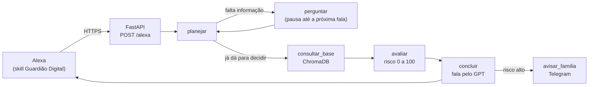

# 🛡️ Guardião Digital


-FF6F00?style=for-the-badge)


**Um assistente de voz que ajuda pessoas idosas a descobrir, na hora, se uma mensagem
ou ligação é golpe, e avisa a família quando o risco é alto.**

Projeto do **Simula & Simplifica: Algoritmos em Ação** (edição 2026.2).

> "Alexa, abre o Guardião Digital."
> "Oi, eu sou o Guardião. Me conta o que aconteceu."
> "Meu neto mandou mensagem de um número novo pedindo dinheiro no pix, disse que era urgente."
> "Isso tem muita cara de golpe, então não faça o PIX. Ligue para o número antigo do seu
> neto, que está salvo na sua agenda. Vou avisar sua família para te ligar também."

## O problema

Quem recebe uma mensagem suspeita costuma depender de um filho ou neto estar disponível
naquele instante para saber se é golpe. Quando ninguém responde a tempo, a pressão do
golpista vence. Sob medo e pressa, muitos idosos não usam buscador. Falar em voz alta
é o jeito mais natural de pedir ajuda.

## O que o Guardião faz

1. **Escuta o relato.** A pessoa conta o que aconteceu do jeito dela, e o Guardião só
   pergunta o que ficou faltando.
2. **Compara com golpes reais.** A situação é cruzada com uma base de 26 golpes
   brasileiros documentados por fontes oficiais (Febraban, INSS, Banco Central, Correios,
   Receita Federal, CERT.br).
3. **Orienta sem termos técnicos.** Uma ou duas frases calmas com uma ação clara. Quando
   não há sinal de golpe, tranquiliza.
4. **Avisa a família.** Se o risco for alto, um familiar recebe um alerta no Telegram.

**Regra fixa:** o Guardião nunca diz "pode pagar". Na dúvida, a orientação é sempre
confirmar por outro canal.

## Como funciona

A Alexa cuida só da voz. Toda a decisão acontece no backend, num grafo de decisão em
LangGraph:



- **Sessão:** cada fala traz o `sessionId` da Alexa, que vira o `thread_id` no checkpointer
  do LangGraph. O nó `perguntar` pausa o grafo com `interrupt()` e devolve
  `shouldEndSession: false`; a fala seguinte retoma a execução de onde parou, acumulando
  as respostas parciais no estado.
- **Interpretação:** regras com palavras-chave primeiro, que são rápidas e previsíveis. O
  GPT só entra quando as regras não entendem, e tira vários campos do relato numa chamada só.
- **Base de golpes (RAG):** os 26 casos em `data/golpes/golpes.json` foram curados à mão de
  fontes oficiais para evitar ruído na busca. Antes de comparar os textos no ChromaDB, a
  busca filtra pelo mesmo pedido e remetente — assim um pedido de código nunca recebe a
  orientação de um golpe de PIX.
- **Risco:** é a soma de uma tabela de sinais explicáveis: pedido de senha ou código,
  número novo, urgência, instituição pedindo algo por mensagem, parecer com um golpe da
  base… Faixas: **baixo** (< 40), **médio** (40 a 69) e **alto** (≥ 70, avisa a família).
  Ver `backend/graph/risco.py`.
- **Fala:** o GPT escreve a fala a partir de uma decisão que **ele não toma**. Se ele
  autorizar pagamento, citar nome de golpe, garantir que é seguro, passar do tamanho ou
  demorar mais de 3 s, vale a fala pronta escrita à mão.
- **Tempo:** cada fala responde entre 0,01 e ~3,5 s, dentro dos ~8 s que a Alexa espera.

## Privacidade (LGPD)

- A memória da conversa é apagada quando a sessão termina.
- Os logs do servidor guardam só o tipo de pedido, a etapa e o tempo, nunca o que foi falado.
- O alerta do Telegram leva o nível de risco, os sinais e a orientação, sem falas, nomes nem valores.
- Nos traces do Langfuse, números (telefone, valores, CPF) viram `[número]`.

Detalhes em [`docs/privacidade.md`](docs/privacidade.md).

## Estrutura

| Caminho | Conteúdo |
| --- | --- |
| `backend/app.py`, `backend/alexa.py` | Endpoint da Alexa: sessões, ajuda, repetir, parar, validação da skill |
| `backend/graph/` | Grafo em LangGraph: perguntas, interpretação, risco, fala |
| `backend/rag/` | Base de golpes: carga, índice no ChromaDB e busca |
| `backend/alerts/` | Alerta à família pelo bot do Telegram |
| `backend/observabilidade.py` | Traces, tags e scores no Langfuse |
| `data/golpes/golpes.json` | Os 26 golpes curados à mão, cada um com sinais, ação e fonte |
| `skill/` | Modelo de interação da Alexa, ícones e script do túnel ([guia](skill/README.md)) |
| `tests/` | 78 testes: golpes, casos legítimos, fala, endpoint e alertas |
| `docs/` | [Projeto](docs/projeto.md), [roadmap](docs/roadmap.md) e [privacidade](docs/privacidade.md) |

## Rodando localmente

```bash
python3 -m venv .venv
source .venv/bin/activate
pip install -r requirements-dev.txt
cp .env.example .env               # preencha as chaves (tabela abaixo)
python -m backend.rag.indexar      # cria o índice da base de golpes
```

| Variável | Para quê |
| --- | --- |
| `OPENAI_API_KEY`, `OPENAI_MODEL` | Interpretar respostas, buscar na base e escrever a fala (padrão `gpt-6-luna`) |
| `TELEGRAM_BOT_TOKEN`, `TELEGRAM_CHAT_ID` | Alerta à família. O ID sai de `python -m backend.alerts.descobrir_chat` depois do `/start` no bot |
| `ALEXA_SKILL_ID` | Aceitar requisições só da nossa skill |
| `RISK_ALERT_THRESHOLD` | Risco a partir do qual a família é avisada (padrão 70) |
| `LANGFUSE_*` | Observabilidade. `LANGFUSE_MASCARAR=false` só em testes sem dados reais |

Sem a chave da OpenAI, o Guardião funciona só com as regras e com as falas prontas.

### Conversar por texto

```bash
python -m backend.cli     # conversa no terminal, mostra risco, motivos e golpe parecido
python -m pytest          # 78 testes, só com as regras (sem GPT, Langfuse nem Telegram)
```

### Ligar na Alexa

```bash
./skill/subir.sh          # sobe o backend e um túnel HTTPS e mostra a URL do endpoint
```

O passo a passo do console da Alexa, do beta test e da Echo Dot está em
[`skill/README.md`](skill/README.md).

<p align="center">
  
</p>

## Observabilidade

Cada conversa vira uma sessão no Langfuse, com um trace por fala:
- **Nós do grafo** e **chamadas do GPT com nome**: `interpretar_relato`, `classificar_<pergunta>` e `escrever_fala`.
- **Tags** `alexa` ou `cli`, e o intent da Alexa que capturou cada fala.
- **Scores da sessão:** `risco`, `nivel`, `alerta_familia`, `golpe_parecido`, `perguntas`
  e `origem_da_fala` (se a fala veio do GPT ou foi a pronta, e por quê).

## Cronograma

- **Etapa 1 – Observe:** entregue (nota ponderada 9,35).
- **Etapa 2 – Construa:** entrega até 20/10 (2º Ranking liberado em 21/10).
- **Etapa 3 – Apresente:** de 21/10 a 29/10, com a live final às 19h.

O que está feito e o que falta: [`docs/roadmap.md`](docs/roadmap.md).

Fora do escopo desta entrega: WhatsApp, Gmail, redes sociais e leitura de prints por OCR.
