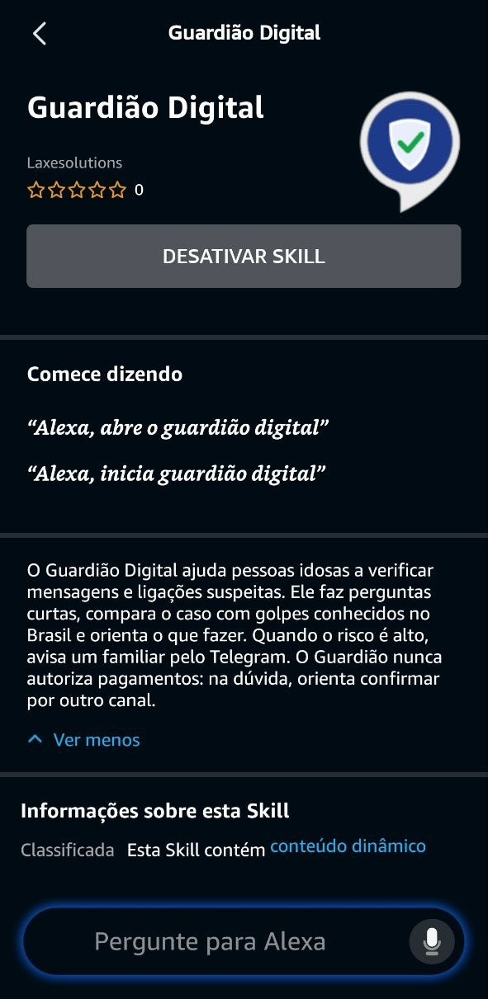

# Skill da Alexa

A skill só cuida da voz: cada fala vai para `POST /alexa` no backend, que devolve a
próxima pergunta ou o veredito.

## Criar a skill no console

1. Em [developer.amazon.com/alexa/console/ask](https://developer.amazon.com/alexa/console/ask),
   crie uma skill chamada **Guardião Digital**:
   - idioma **Portuguese (BR)**, modelo **Custom**;
   - hospedagem **Provision your own** e modelo **Start from scratch**.
2. Em **Build → Interaction Model → JSON Editor**, cole o conteúdo de
   `interaction-model/pt-BR.json`, clique em **Save** e depois em **Build skill**.
3. Copie o **Skill ID** (`amzn1.ask.skill...`) para `ALEXA_SKILL_ID` no `.env`.

## Ligar ao backend

1. Rode `./skill/subir.sh`. Ele sobe o backend e um túnel HTTPS e mostra a URL do endpoint.
2. Em **Build → Endpoint**, escolha **HTTPS**, cole a URL em **Default Region** e,
   no certificado, escolha *My development endpoint is a sub-domain of a domain that
   has a wildcard certificate from a certificate authority*. Salve.
3. A URL do túnel muda toda vez que o script roda. Atualize o endpoint antes de cada teste.
4. O backend recarrega sozinho quando o código em `backend/` muda, sem derrubar o túnel.
   Na apresentação, suba com `RECARREGAR=0 ./skill/subir.sh`.

Se a Alexa responder "Erro ao comunicar-se com a Skill solicitada" e nada chegar no log
do servidor, confira o tipo de certificado: a opção *trusted certificate authority* não
funciona com o domínio `trycloudflare.com`.

## Testar

- **Console:** na aba **Test**, ative *Development* e digite ou fale "abre o guardião digital".
- **Echo Dot da mesma conta Amazon:** com o aparelho em português, diga "Alexa, abre o
  Guardião Digital". Skills em desenvolvimento aparecem sozinhas nos aparelhos da conta.
- **Echo Dot de outra conta:** use o **beta test**.
  1. Em *Distribution → Skill Preview*, preencha nome, descrições, frases de exemplo,
     categoria e os ícones de `assets/` (108 e 512 px). A política de privacidade é
     <https://github.com/machado-leo/guardiao-digital/blob/main/docs/privacidade.md>.
  2. Responda *Privacy & Compliance*.
  3. Em *Availability → Beta Test*, adicione o e-mail da conta Amazon da Dot. A pessoa
     abre o convite logada nessa conta e ativa a skill. O beta dura 90 dias.

  

## Como a conversa funciona

A skill abre com um convite aberto ("Me conta o que aconteceu"), em uma de quatro
variações. O backend tira do relato tudo o que der e só pergunta o que faltou, então
um relato completo pode ir direto ao veredito.

## Como a fala chega no backend

- `RespostaIntent`: respostas curtas ("meu filho", "o banco"), num slot próprio. Às
  vezes a Alexa distorce a fala para parecer com os exemplos ("os Correios" já chegou
  como "gêmeos").
- `FraseIntent`: frases livres com uma palavra de apoio ("meu neto mandou…", "o banco
  ligou…", "pediram a senha"). A Alexa exige essa palavra no `AMAZON.SearchQuery`, e ela
  não chega ao backend: "pediram a senha" chega como "a senha". Os relatos chegam bem
  transcritos por aqui.
- A Alexa escreve "um" e "uma" como "1". O backend só conta um número como dinheiro
  com "reais", "mil" ou "R$" junto.
- "Sim" e "não" chegam pelos intents prontos da Alexa. Ajuda, repetir, parar e "não
  entendi" (`AMAZON.FallbackIntent`) também são tratados pelo backend.

Para ver o que a Alexa transcreveu em cada fala, abra a sessão no Langfuse: cada trace
registra o texto recebido e o intent que o capturou.
